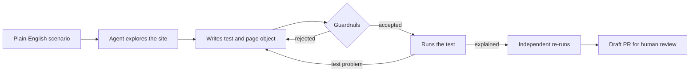

# AI Test Agent for Playwright and pytest

An AI agent that turns plain-English scenarios into Playwright tests, triages CI failures, and
keeps a person in charge of what gets merged. It's built on the Claude API and runs against
[SauceDemo](https://www.saucedemo.com/), a public practice site.

The hard part of AI-written tests isn't generating code. It's knowing whether to trust the result:
a test can pass while proving nothing, and an agent can "fix" a real bug by weakening the assertion.
This project is designed around that problem.

## How it works



### Test writer: `python -m agent write`

A tool-using agent inspects the live page, follows the project's existing conventions, writes the
test, then runs and fixes it. If the application itself looks wrong, it keeps the correct assertion
and reports `bug_suspected`.

The agent's claim isn't taken at face value. The harness re-runs the tests twice and sets the status:

| Status | Meaning |
|---|---|
| `passed` | The agent reported a pass, and both runs passed |
| `bug_suspected` | The agent reported a bug, and the tests failed on both runs |
| `flaky` | The two runs disagreed |
| `failed` | The agent's claim didn't match the test results |
| `blocked` | The agent gave up, or hit the turn or cost limit |

### Failure triage: `python -m agent triage`

When CI fails, each failed test is classified as `product_bug`, `test_bug`, `flaky` or
`environment`, using its JUnit report and Playwright trace (failed steps, console errors and failed
requests). The result is posted to the PR as a suggestion, with the evidence and a confidence level.
It never changes whether the check passes.

### Guardrails

These are enforced in code in [agent/safety.py](agent/safety.py) and
[agent/tools.py](agent/tools.py), so they hold whatever the model decides to do:

- **Weak tests are rejected:** no assertions, constant assertions, match-anything patterns, skips,
  `xfail`, and `try/except` around assertions.
- **Flaky patterns are rejected:** fixed sleeps and `wait_for_timeout`.
- **Limited file access:** the agent can only create files in `src/pages/` and `tests/generated/`.
  Existing files are read-only, so it can't edit a test to make it pass.
- **Limited browsing:** page inspection stays on the application under test.
- **Spending limits:** every run has a turn limit and an estimated cost limit.
- **No secrets in test runs:** API keys and GitHub tokens are removed from the test environment.
- **Human review:** the agent has no git access, and CI opens a draft PR that a person must review.

### Known limits

- The guardrails are a quality gate, not a security sandbox. Generated code does run, so use a
  disposable checkout or CI runner. To make review mandatory, also turn on branch protection.
- Static checks can't catch every weak test. For example, a test can assert something true but
  unimportant, which is why review stays with a person.
- A single CI run often can't separate `flaky` from other causes, so triage reports its confidence.
- The trace format is internal to Playwright and may change, in which case triage falls back to the
  JUnit report.

## Measuring it

```bash
python -m agent eval writer
```

```bash
python -m agent eval triage
```

Both make real API calls and cost money, so try `--limit 1` first. Results are saved to
`evals/results/`.

- **Writer:** [8 scenarios](evals/writer_scenarios.json) with known outcomes. Two target SauceDemo's
  deliberately broken `problem_user`, where the right answer is `bug_suspected`. The login scenarios
  hide the existing login tests, so the agent can't copy them.
- **Triage:** [12 hand-written failures](evals/triage_cases.json), three per label. These are
  synthetic examples, so scores show how well it handles clear-cut cases, not real CI accuracy.

## Setup

```bash
python3 -m venv .venv
```

```bash
source .venv/bin/activate
```

```bash
pip install uv && uv sync --all-extras --dev
```

```bash
playwright install chromium
```

```bash
export ANTHROPIC_API_KEY=your-key
```

Then generate a test:

```bash
python -m agent write "A locked-out user can't log in and sees an explanation"
```

Results land in `tests/generated/`. Review them before committing.

## Running tests

| Command | What it runs |
|---|---|
| `pytest` | The Playwright suite in a visible browser |
| `HEADLESS=1 pytest` | The same suite with no browser window |
| `pytest -m devRun` | The pre-merge subset |
| `pytest agent_tests` | The agent's own tests, with no browser or API key needed |
| `allure serve allure-results` | The Allure report for the last run |

To inspect a failure, upload its `test-results/<test>/trace.zip` to the
[Playwright Trace Viewer](https://trace.playwright.dev/).

## CI

| Workflow | Trigger | What it does |
|---|---|---|
| [devRun.yml](.github/workflows/devRun.yml) | Pull request | Runs agent tests and pre-merge tests, and posts triage on failure |
| [agentGenerate.yml](.github/workflows/agentGenerate.yml) | Manual | Generates a test and opens a draft PR |
| [nightly.yml](.github/workflows/nightly.yml) | Nightly | Runs the full regression suite |

Repository setup:

1. Add the `ANTHROPIC_API_KEY` secret. Tests still run without it, but triage and test generation won't.
2. Under **Settings > Actions > General**, allow GitHub Actions to create pull requests.
3. Optional: set the `BASE_URL` variable to test another site. The default is SauceDemo.

## Credits

The test framework was originally based on
[Playwright-Python-Example](https://github.com/nirtal85/Playwright-Python-Example) by Nir Tal,
used under the [Apache License 2.0](LICENSE).

Changes from that project: added the `agent/`, `agent_tests/` and `evals/` folders and the
`agentGenerate.yml` workflow; made browser mode configurable in `tests/conftest.py`; updated
`pyproject.toml`, `uv.lock`, `.gitignore` and the CI configuration; rewrote this README; and removed
the funding file.
